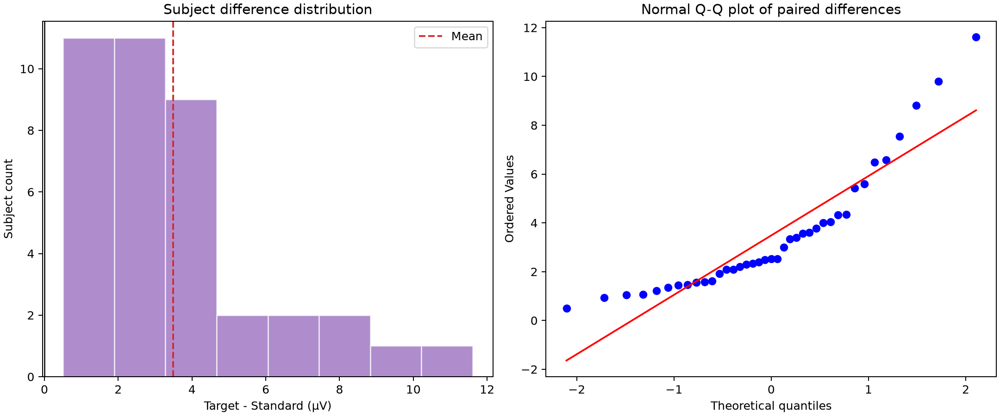
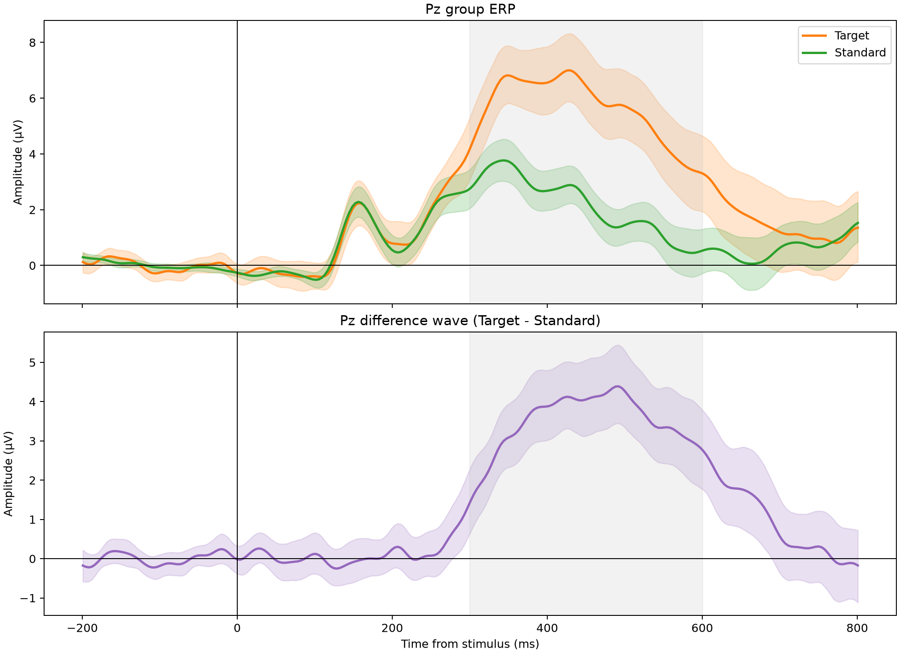
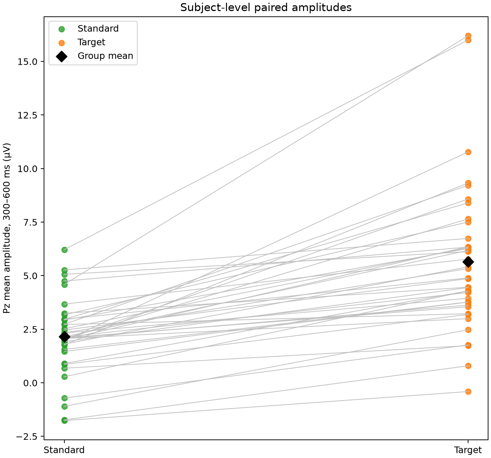
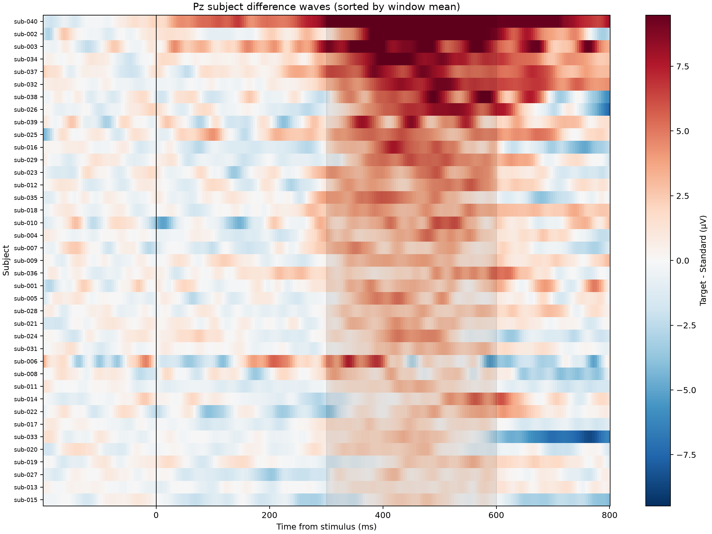
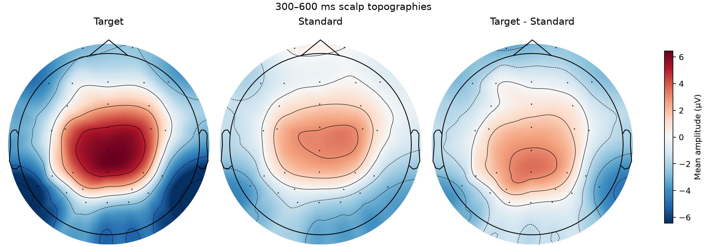
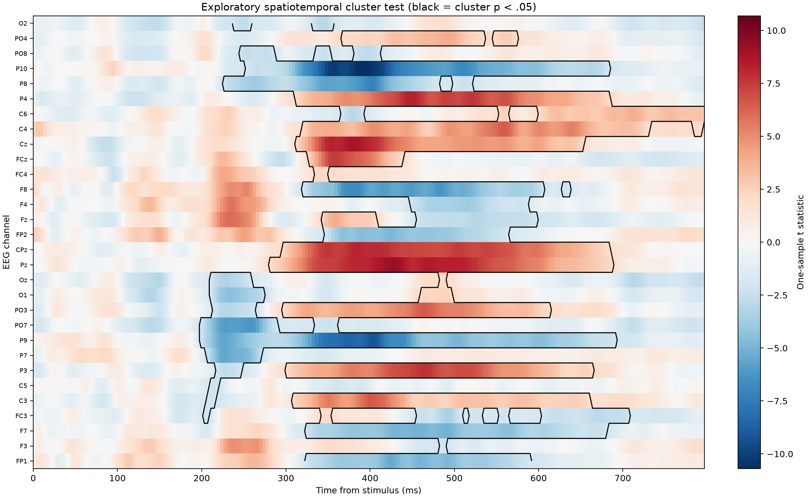

# Phase 5：经典 P3b 分析结果

## 1. 阶段结论

Phase 5 已完成。裁决版39名受试者在 Pz、300--600 ms 的 Target 平均电位显著高于 Standard，且效应在不同人工 QC 决策、非参数检验和最低 trial 数检查下保持稳定。

预先定义的主要结果为：

- Target 平均幅值：5.650 µV，SD = 3.427 µV；
- Standard 平均幅值：2.165 µV，SD = 1.733 µV；
- Target - Standard 平均差：3.486 µV；
- 95% 受试者 bootstrap CI：[2.738, 4.323] µV；
- 配对 t 检验：t(38) = 8.476，p = 2.732 × 10⁻¹⁰；
- 配对效应量：Cohen's dz = 1.357。

因此，本项目在进入时频特征和机器学习前，已经建立了清晰、方向一致且效应量较大的经典 P3b 基线。

## 2. 输入与统计单位

正式输入为 `data/processed/epochs/adjudicated` 中39名受试者的裁决版 epochs：

- Target：共1286个epoch，每人5--40个；
- Standard：共5921个epoch，每人127--160个；
- 主分析排除：`sub-030`；
- 主分析电极：Pz；
- 主分析时间窗：300--600 ms。

程序逐人读取 epochs，在每名受试者内部先形成 Target 和 Standard 条件平均，再将每人一个条件值送入群体统计。因此群体检验的样本量是39，而不是7207，不存在把同一受试者的trial当作独立样本的伪重复。

Target 和 Standard 的trial数不同是oddball任务本身的设计特征。条件内平均不会因Standard trial更多而给某名受试者更高的群体权重；每名受试者在配对检验中仍只贡献一个差值。

## 3. 主要统计结果

| 指标 | Target | Standard | Target - Standard |
|---|---:|---:|---:|
| Pz 300--600 ms平均幅值 | 5.650 µV | 2.165 µV | 3.486 µV |
| 组内标准差 | 3.427 µV | 1.733 µV | 2.568 µV |
| 差值中位数 | — | — | 2.525 µV |
| 差值95% bootstrap CI | — | — | [2.738, 4.323] µV |

配对 t 检验回答的是39名受试者的平均条件差是否偏离0。Cohen's dz 使用受试者差值的标准差进行标准化，与配对设计一致。这里 dz = 1.357，说明平均条件差相对于个体差异具有较大的标准化幅度。

置信区间没有跨越0，并且它比单独的p值更直观地给出了合理效应范围：当前数据支持的群体平均差大约为2.74--4.32 µV。

## 4. 分布检查与稳健性

配对差值呈明显右偏：Shapiro-Wilk W = 0.847，p = 8.958 × 10⁻⁵。这主要来自少数效应较大的受试者，不能仅依赖正态近似来描述不确定性。

本项目没有因此事后更换主要检验，而是同时报告：

- 预先定义的配对 t 检验；
- 对受试者成对重采样的5000次bootstrap置信区间；
- Wilcoxon符号秩稳健性检查。

39名受试者的 Target - Standard 平均差全部为正。Wilcoxon结果为 W = 0，p = 3.638 × 10⁻¹²，配对秩二列相关 = 1.000。这说明主要结论不是由右尾的少数大效应单独制造的，但效应大小仍应以均值差、置信区间和 dz 为主进行解释。



## 5. 次要指标

下表属于次要分析，没有进行多重比较校正，不能与唯一的主要检验等价解释。

| 指标 | Target均值 | Standard均值 | 平均差 | t(38) | 未校正p | dz |
|---|---:|---:|---:|---:|---:|---:|
| Pz峰值幅值 | 8.568 µV | 4.853 µV | 3.715 µV | 9.013 | 5.652 × 10⁻¹¹ | 1.443 |
| Pz峰值潜伏期 | 412.059 ms | 384.816 ms | 27.244 ms | 2.721 | 0.009753 | 0.436 |
| Pz有符号面积 | 1.685 µV·s | 0.645 µV·s | 1.040 µV·s | 8.503 | 2.524 × 10⁻¹⁰ | 1.362 |
| 后部ROI平均幅值 | 3.659 µV | 1.184 µV | 2.475 µV | 7.787 | 2.176 × 10⁻⁹ | 1.247 |

峰值幅值和潜伏期比窗口平均更容易受到采样点和残余噪声影响，因此它们只用于补充描述。峰值潜伏期差也不能直接解释为某个认知过程“延迟27 ms”，因为两个条件窗口内最大点未必代表完全相同的成分。

## 6. QC决策与trial数敏感性分析

| 数据集 | N | 平均差 | 95% CI | t | p | dz |
|---|---:|---:|---:|---:|---:|---:|
| 主分析裁决版 | 39 | 3.486 µV | [2.738, 4.323] | 8.476 | 2.732 × 10⁻¹⁰ | 1.357 |
| 额外排除sub-025 | 38 | 3.463 µV | [2.699, 4.321] | 8.216 | 7.281 × 10⁻¹⁰ | 1.333 |
| 加回sub-030 | 40 | 3.532 µV | [2.782, 4.366] | 8.754 | 9.627 × 10⁻¹¹ | 1.384 |
| 事后要求Target trial ≥ 20 | 36 | 3.531 µV | [2.719, 4.449] | 7.957 | 2.325 × 10⁻⁹ | 1.326 |

前三行回答人工 QC 裁决是否改变结论。三种版本的平均差、置信区间和效应量非常接近，因此结论不依赖 `sub-025` 或 `sub-030` 的单一个案决定。

生成受试者测量表后发现 `sub-006`、`sub-010`、`sub-035` 分别只保留5、8、18个Target trial，因此增加了最后一行事后检查。排除这些低Target计数受试者后效应仍稳定。由于这项检查是在看到trial计数后增加的，配置和报告均明确标注为post hoc，不能冒充预先定义的分析。

## 7. 波形应该怎么看



图中实线是39名受试者条件平均的再平均，阴影是对受试者进行5000次bootstrap得到的95%置信区间，灰色区域是预先固定的300--600 ms主窗口。

可观察到：

- 刺激前两条件均接近0 µV，说明基线没有明显整体偏移；
- 约300 ms后Target开始明显高于Standard；
- 差异在300--600 ms持续存在，而不是由单个尖锐采样点造成；
- 差异波在约400--500 ms附近最大，符合本项目测量的P3b时间范围。

不能从阴影是否重叠直接判断配对显著性，因为两条阴影分别描述条件均值；正式推断来自每名受试者的成对差值。

## 8. 个体一致性应该怎么看



每条灰线连接同一名受试者的Standard和Target。39条线均向上，说明方向高度一致。少数Target值较大的受试者解释了差值分布的右尾，但并没有出现方向相反的个体。



热图每行代表一名受试者，按300--600 ms平均差从小到大排列；红色表示Target比Standard更正。它展示了两个事实：多数受试者在主窗口存在正差异，同时不同受试者的幅值和峰值时间并不完全相同。这种个体差异是后续单试次建模需要面对的真实问题。

## 9. 头皮分布应该怎么看



Target - Standard头皮图显示中央—顶叶区域的正差异，Pz位于这一正场范围内，因此主通道结果不是孤立的单电极异常。

头皮电位是参考方式和体积传导共同形成的传感器空间分布，不能把红色区域直接解释成脑源位置。平均参考下，同一电场通常同时包含正区和负区；若要讨论解剖来源，需要单独的源定位模型和MRI/头模型支持，本阶段不作此推断。

## 10. 探索性时空cluster permutation

2000次时空置换得到两个 p < 0.05 的簇，置换分辨率下最小可报告p值为1/2000 = 0.0005：

1. 正簇：281--797 ms，覆盖16个中央—顶叶相关通道，峰值位于Pz、426 ms，峰值t = 9.269，簇p = 0.0005；
2. 负簇：199--707 ms，覆盖22个通道，峰值位于P10、391 ms，峰值t = -10.694，簇p = 0.0005。



图中颜色是逐通道、逐时间点的一样本t统计量，黑色边界表示属于显著簇的时间—通道采样点。cluster检验回答的是相邻时间和相邻电极组成的整体是否超过置换零分布，不表示边界内每一个采样点都能单独通过显著性检验。

正、负两个空间簇可能是同一平均参考电场的不同极性区域，也可能混合了多个成分，不能直接解释为两个独立脑源。该结果只作为预先标记的探索性空间—时间补充，不能反向修改Pz、300--600 ms的主要分析。

## 11. 输出文件

| 文件 | 内容 |
|---|---|
| `results/erp_analysis/subject_measurements.csv` | 每名受试者的trial数、平均幅值、峰值、潜伏期、面积和ROI指标 |
| `results/erp_analysis/group_statistics.csv` | 主要、稳健性和次要群体统计长表 |
| `results/erp_analysis/sensitivity_analysis.csv` | 39/38/40人与事后低trial敏感性结果 |
| `results/erp_analysis/group_waveforms.csv` | 各时间点的群体均值与bootstrap区间 |
| `results/erp_analysis/group_topographies.csv` | 30个EEG通道的条件和差值平均幅值 |
| `results/erp_analysis/cluster_summary.csv` | 每个时空簇的p值、极性、范围、峰值和通道 |
| `results/erp_analysis/cluster_permutation_results.npz` | 完整t矩阵、簇掩码、置换零分布和轴信息 |
| `results/erp_analysis/analysis_manifest.json` | 配置哈希、输入清单、软件版本和运行参数 |
| `results/erp_analysis/results_summary.md` | 每次运行自动生成的精简结果摘要 |

## 12. 复现命令

在项目根目录运行：

```powershell
& 'D:\LearnWareSoft\Aanconda\_conda.exe' run -n erp-core-p3b `
    python scripts/05_run_erp_analysis.py
```

该命令会逐人读取39个epoch文件，重建所有CSV、JSON、NPZ和PNG结果。正式结果使用配置中的2000次置换；`--skip-cluster`和`--permutations`只用于开发检查，不应用于最终报告。

## 13. 阶段验收

- [x] 39名受试者的输入、条件、通道、采样率和时间轴一致；
- [x] Pz、300--600 ms和平均幅值在统计前冻结；
- [x] 群体统计以受试者为单位，没有trial级伪重复；
- [x] 报告均值差、置信区间、精确p值和配对效应量；
- [x] 同时展示群体波形、个体配对、个体热图和头皮分布；
- [x] 主分析、次要分析、探索性分析和事后敏感性分析明确分开；
- [x] 2000次时空cluster permutation完成；
- [x] 代码静态检查通过，17项自动化测试全部通过；
- [x] 单一命令可从裁决版epochs重建结果。

Phase 5 至此完成。下一阶段是 Phase 6：Morlet时频、频带功率、离散小波特征及训练折内PCA。

