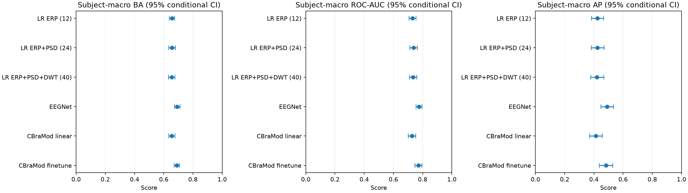
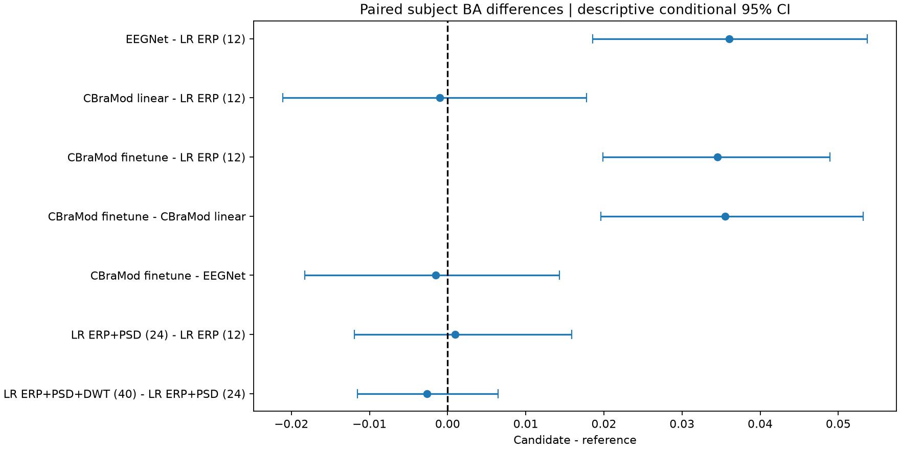
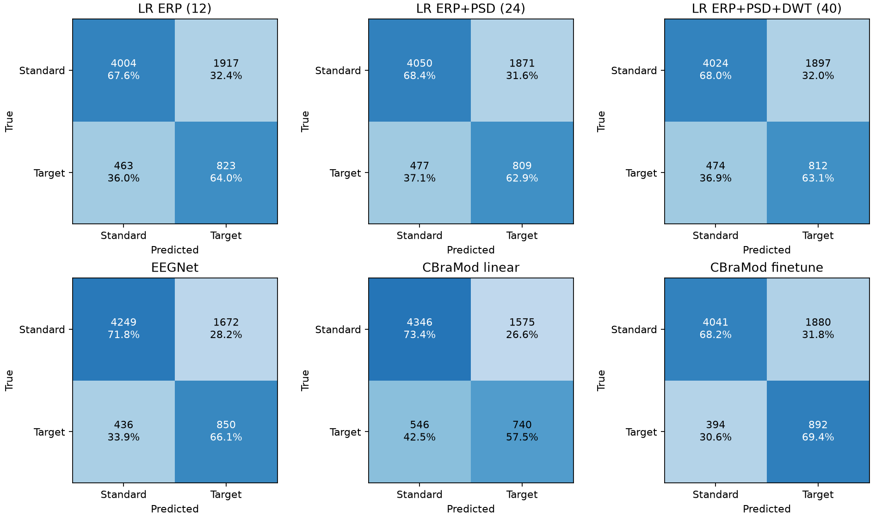

# GitHub公开结果包

本包汇总已完成的ERP CORE P3b信号处理和分类结果。主要评价使用39名受试者等权指标，
数据为7207个保留trial（1286 Target、5921 Standard），所有6模型共用固定受试者五折。
完整方法见[项目首页](../../README.md)和[结果解读](../../docs/15_final_results_and_error_analysis.md)。

## 经典ERP

Pz 300–600ms：Target−Standard为3.486µV，95%受试者bootstrap CI [2.738,4.323]µV，
t(38)=8.476，p=2.732×10⁻¹⁰，Cohen's dz=1.357。
条件均值在每人内部计算，群体统计单位为39名受试者。
详见[Phase 5结果](../../docs/07_p3b_results.md)。

## 分类结果

|模型|macro BA|macro ROC-AUC|macro AP|
|---|---:|---:|---:|
|LR ERP12|0.6557|0.7310|0.4249|
|LR ERP+PSD24|0.6566|0.7373|0.4242|
|LR ERP+PSD+DWT40|0.6540|0.7353|0.4213|
|EEGNet|0.6917|0.7744|0.4910|
|CBraMod linear|0.6547|0.7270|0.4129|
|CBraMod finetune|0.6902|0.7715|0.4832|

EEGNet与CBraMod微调表现接近。微调−EEGNet的配对BA差为−0.0016，
条件95% CI [−0.0183,0.0143]，提高20人、降低19人；没有稳定方向的差异证据。
EEGNet−ERP LR为+0.0361，条件CI [0.0186,0.0537]；
微调−ERP LR为+0.0345，条件CI [0.0199,0.0489]。
当前特征/分类器设置下增加功率或DWT没有明确的BA增量。

## 错误分析

全部trial混合计数中，EEGNet检出850个Target、漏检436个、误报1672个Standard；
微调检出892个、漏检394个、误报1880个。
微调少漏检42个Target，同时多误报208个Standard，需要结合召回与特异度评价。

始终预测Standard的accuracy为82.16%，但BA为0.5。
因此主报告使用BA、ROC-AUC、AP和Target指标。macro与pooled的权重不同，不能直接互换。
三网络共同错误988个trial；对应原trial身份和39份个体分析由本地14报告生成。

## 聚合表和来源

|文件|说明|
|---|---|
|[model_overview.csv](tables/model_overview.csv)|6模型macro指标和BA条件CI|
|[subject_macro_ci.csv](tables/subject_macro_ci.csv)|各macro指标的条件受试者bootstrap CI|
|[paired_comparisons.csv](tables/paired_comparisons.csv)|7组固定对照、差值CI、提高/降低/同分人数|
|[pooled_metrics.csv](tables/pooled_metrics.csv)|辅助trial混合指标、TP/FN/FP/TN|
|[compute_summary.csv](tables/compute_summary.csv)|五折拟合时长、可训练参数与显存分配峰值|
|[experiment_record.json](experiment_record.json)|数据/划分/权重身份和上游摘要hash，使用项目相对路径|
|[environment_record.json](environment_record.json)|实际软件/硬件版本记录，非完整跨平台环境锁|
|[artifact_manifest.json](artifact_manifest.json)|聚合表和精选图的来源路径、文件大小与SHA-256|

表和图逐字节复制自已核验的`results/final_report/v1`，没有为展示重新计算或挑选新成绩。
小数显示四位；CI按受试者重采样、条件于既有固定划分和模型，不含重新拟合方差。
单模型CI使用受试者编号排序，与早期按fold排序的有限Monte Carlo端点可能略有差别。

## 结论范围与复现

本实验只有一个训练seed设置，配对对照为描述性分析，未做多重比较校正或标签置换检验。
CBraMod使用单patch及ERP预处理，EEGNet/CBraMod采样网格不同；结果不代表多patch优势或跨数据集结论。
整段离线ICA/QC的受试者分组评价与严格在线预处理有不同范围。
Target/Standard是健康受试者任务条件，不是疾病诊断标签。

依次复现09–14可得到本地完整结果，参数和命令见
[特征/LR](../../docs/13_classification_features_and_lr.md)、
[深度学习](../../docs/14_deep_learning_export_and_training.md)、
[最终报告](../../docs/15_final_results_and_error_analysis.md)。
本包不包含EEG原始数据、FIF、中间数组、作者源码副本、预训练权重或完整trial预测。

ERP CORE数据来源及CC-BY-4.0许可记录来自本地BIDS `dataset_description.json`，
原数据获取见[下载说明](../../docs/01_dataset_and_download.md)。
CBraMod作者代码MIT许可与权重Hub的Apache-2.0元信息分别记录，资源获取见08说明；
这些上游许可记录不自动定义本项目自有源码的许可证。
